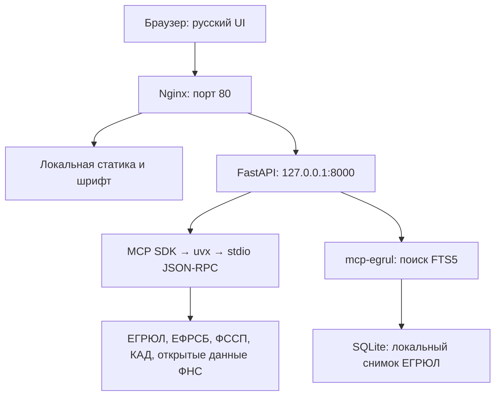

# ФНС РУС

**FNSRUS 1.2** - русскоязычный интерфейс и серверная обвязка для проверки
российских контрагентов. [Репозиторий](https://github.com/DgekStr/FNSRUS),
[первый релиз 1.0](https://github.com/DgekStr/FNSRUS/releases/tag/1.0).

Русскоязычный веб-интерфейс проверки российских контрагентов по ИНН, ОГРН
или названию на базе бесплатных open-source серверов
[atomno-mcp-fns-check](https://github.com/atomno-mcp/mcp-fns-check) и
[atomno-mcp-egrul](https://github.com/atomno-mcp/mcp-egrul).

Приложение предназначено для доверенной локальной сети. Быстрый запуск:
`http://127.0.0.1:8000/`. Перед публичным развёртыванием нужны HTTPS и авторизация.


[Мобильный интерфейс](docs/screenshots/mobile.png) |
[Настройки API-ФНС](docs/screenshots/settings.png) |
[Истоки и источники проекта](docs/origins.md) |
[Подготовка и состав релиза](docs/release-1.0.md) |
[История изменений](CHANGELOG.md)

## Возможности

- Проверка по ИНН юрлица / ИП и ОГРН / ОГРНИП с проверкой контрольной цифры.
- Поиск юрлиц по названию; в выдаче показаны название, кликабельный ИНН и город.
- Переход из совпадения к полной карточке и возврат к сохранённым результатам.
- Основные сведения, регистрация, руководство, адрес, риски, вердикт и ОКВЭД.
- Все поля, возвращённые источником, включая массивы, ошибки и метаданные.
- Копирование каждого поля и полного JSON. На HTTP используется резервный
  механизм копирования; на HTTPS — Clipboard API, если он разрешён браузером.
- Пустые значения отображаются как «—». При копировании сохраняются исходные
  значения: строки без кавычек, числа без округления, `null`, `[]` или `{}`.
- Адаптивная вёрстка для телефона, планшета и настольного браузера.
- Светлая тема по умолчанию, тёмная тема с сохранением выбора в браузере.
- Доступ к семи MCP-инструментам через HTTP API, без LLM и без API-ключа.

## Архитектура



Обвязка выполняет MCP-инициализацию, обнаруживает настоящую схему инструмента,
проверяет параметры, вызывает инструмент и завершает подпроцесс.
Один процесс FastAPI допускает одну активную операцию и до 10 вызовов в минуту
суммарно для всех клиентов. Таймаут MCP-вызова — 50 секунд, Nginx — 60 секунд.

## Требования

- Ubuntu 24.04, Python **3.11+**; рабочий контейнер использует Python 3.12.
  Python 3.10 не подходит: upstream-пакет требует 3.11 или новее.
- Nginx, uv / uvx, доступ сервера к PyPI и публичным источникам.
- Для поиска по названию нужна отдельно загруженная официальная база ЕГРЮЛ;
  пакет не скачивает её автоматически. Условия и порядок импорта описаны ниже.
- Ориентир: 1 vCPU, 1,5 ГБ RAM. Systemd ограничивает приложение 512 МБ и 80% CPU.
- Современный браузер с поддержкой модулей JavaScript и BigInt.

## Структура

```text
FNSRUS/
├── server.py
├── api_fns.py
├── test_server.py
├── VERSION
├── requirements.txt
├── templates/index.html
├── static/
│   ├── style.css
│   ├── app.js
│   └── vendor/       # Иконки, шрифт и лицензии; без CDN
├── systemd/mcp-fns-ui.service
├── nginx/mcp-fns.conf
├── docs/
│   ├── deployment.md
│   ├── api.md
│   ├── origins.md
│   ├── release-1.0.md
│   └── screenshots/
├── .github/workflows/ci.yml
├── CHANGELOG.md
├── .env.example
├── .gitignore
├── .gitattributes
├── README.md
└── LICENSE
```

## Установка и запуск

Полная инструкция: [docs/deployment.md](docs/deployment.md).

Краткий ручной запуск после установки uvx и предварительного скачивания MCP-пакета:

```bash
cd /srv/mcp-fns
python3 -m venv .venv
.venv/bin/pip install -r requirements.txt
mkdir -p data
uvx --from atomno-mcp-fns-check==0.1.12 atomno-mcp-fns-check --version
uvx --from atomno-mcp-egrul==0.1.10 atomno-mcp-egrul --version
UVX_PATH="$(command -v uvx)" HOST=127.0.0.1 PORT=8000 .venv/bin/python server.py
```

Открыть `http://127.0.0.1:8000/` на той же машине.
Настройки берутся из переменных окружения. `.env` сам по себе не загружается:
systemd читает `/etc/mcp-fns.env`, если файл существует.
`FNS_API_KEY` в шаблоне оставлен пустым. Он поддерживается как начальное значение
из окружения, если сохранённых настроек ещё нет. Не помещайте настоящий ключ
в `.env.example`.

## Поиск по названию

Текстовый запрос выполняется через `search_by_name` сервера `mcp-egrul`.
Ввод в `/api/check` автоматически направляется на проверку, если состоит из
10/12/13/15 цифр, и на поиск по названию в остальных случаях. Отдельный
`POST /api/search` возвращает до 50 результатов с полями `name`, `inn`, `city`.
Нажатие на ИНН открывает полную карточку; кнопка возврата восстанавливает список.

**Важно:** пакет `atomno-mcp-egrul` сам не скачивает снимок ФНС. До получения
данных нужно принять условия open-data на сайте ФНС и вручную скачать ZIP-выгрузку.
Полный архив занимает около 15 ГБ, первичный импорт upstream оценивает в 30-60 минут.
На сервере база должна находиться по пути `/var/lib/mcp-fns/egrul.sqlite`; подробная
команда импорта приведена в [инструкции развёртывания](docs/deployment.md).
Без загруженной базы API явно сообщает, что реестр не готов, а не показывает
ложное сообщение «ничего не найдено».
Снимок open-data может отставать от текущих сведений ФНС на 1-7 дней, поэтому
недавно зарегистрированные компании могут ещё отсутствовать.

## Подключение API-ФНС

Откройте настройки в шапке, введите ключ api-fns.ru, включите «Использовать
API-ФНС» и сохраните. Перед сохранением сервер проверяет доступ через `stat`.
Ключ хранится только на сервере в файле с правами 0600, заданном
`FNS_SETTINGS_PATH`; в systemd это `/var/lib/mcp-fns/api-fns-settings.json`.
При ручном запуске без этой переменной используется `data/api-fns-settings.json`.
Ключ не возвращается в ответах, не передаётся MCP-подпроцессу и не сохраняется
в хранилище браузера. Внешние запросы сначала выполняются HTTPS POST.
Только при HTTP 401/403 используется документированный HTTPS GET; параметры
его URL удаляются из журналов приложения. На HTTP запросы не переключаются.
В статистике ключа поле `Статус` может отсутствовать: допускается ответ
с датами действия и статистикой методов, как в текущем API-ФНС.
Перезапуск для изменения настроек не нужен. Отключение сохраняет ключ,
удаление очищает его и отключает интеграцию, даже если ключ задан в окружении.

Агрегированный `/api/check` и MCP-маршрут `check_contractor` дополняются
методами `egr` и `check`; остальные шесть MCP-маршрутов сохраняют прежнее поведение.
Полные ответы поставщика доступны в JSON и в разделе «Аналитика API-ФНС».
Если API-ФНС недоступен, сохраняется доступный отчёт открытых источников с ошибкой
поставщика. Если открытая карточка недоступна, её может заменить карточка API-ФНС.
Адрес, ОКВЭД и учредители берутся из ответа, отсутствующие поля не выдумываются.
В покрытие засчитываются только явные ответы массового адреса и руководителя
и положительный признак налоговой недоимки. Отсутствие поля не означает «Нет»;
отрицательный признак недоимки свыше 1000 руб. не исключает меньшую задолженность.
Источники ФССП, КАД и ЕФРСБ автоматически не заменяются. Один отчёт расходует
по одному успешному запросу `egr` и `check`; проверка ключа использует `stat`.
При отказе POST возможна одна дополнительная попытка GET для каждого метода.
Условия учёта отказавших запросов зависят от поставщика.

API-ФНС — сторонний сервис ДаМИА, не официальный API налоговой службы.
Для интеграции нужен доступ к `egr` и `check`, а не только тариф с `multinfo`.
В тестовом бесплатном режиме ключ разрешён только с одного IP-адреса;
его можно изменить в личном кабинете API-ФНС. Укажите внешний IP сервера,
с которого приложение отправляет запросы, а не локальный адрес сервера
или внешний адрес компьютера с браузером. Если эти внешние адреса различаются,
после смены привязки прямой запрос из браузера может перестать работать.
При динамическом внешнем IP привязку потребуется обновить после его изменения.
Настройки API доступны только клиентам из `FNS_SETTINGS_LAN_NETWORKS`
(по умолчанию `192.168.0.0/24`, внутренний NAT-шлюз `10.1.17.6/32` и loopback);
сервер отклоняет внешние запросы.
Отдельной авторизации пока нет. На HTTP ключ передаётся от браузера серверу без
шифрования; интерфейс показывает предупреждение. Для недоверенной сети обязательны
HTTPS и авторизация.

## Использование

Введите, например, `7707083893` и нажмите «Найти» либо Enter.
Вердикт учитывает доступность источников, а не только пустой список рисков.
Проверьте разделы «Риски» и «Источники и актуальность» перед принятием решения.
Кнопки «Копировать» и «Копировать всё» возвращаются в исходное состояние через 2 секунды.
Кнопка «Очистить» сбрасывает форму и результат, отменяя ожидание текущего запроса.

Описание HTTP API: [docs/api.md](docs/api.md).

```bash
curl -s http://192.168.0.45/api/check \
  -H 'Content-Type: application/json' \
  -d '{"identifier":"7707083893"}'

curl -s http://192.168.0.45/api/search \
  -H 'Content-Type: application/json' \
  -d '{"query":"сбер"}'
```

## Проверка

```bash
cd /srv/mcp-fns
.venv/bin/python -m unittest test_server -v
runuser -u deploy -- env FNS_LIVE_TESTS=1 \
  MCP_FNS_REGISTRIES_DB=/var/lib/mcp-fns/registries.sqlite \
  .venv/bin/python -m unittest test_server -v
```

Первый запуск не обращается к внешним источникам; второй включает один живой
отчёт Сбербанка в окружении серверной установки. Команда `runuser` выполняется
от root. При локальном запуске используйте своего пользователя и доступный ему
каталог `data` вместо `/var/lib/mcp-fns`. Не запускайте живые тесты часто — они учитываются источниками.
Проверяются сохранение JSON, семь имён инструментов, ошибки параметров,
лимит, занятость, таймаут, сбой транспорта и отсутствие повторного использования кэша.

## Ограничения и достоверность

- До 10 запросов в минуту на IP по условиям источников. Один агрегированный
  вызов может выполнять несколько сетевых запросов; лимит обвязки не заменяет
  лимиты самих сайтов и не обходит их.
- Кэш карточек `mcp-fns-check` создаётся во временном каталоге для каждого
  вызова. SQLite `mcp-egrul` хранит только отдельно импортированный снимок ЕГРЮЛ
  и не является кэшем ответов онлайн-проверок.
- Сам upstream-пакет умеет постоянный SQLite-кэш; его существующие записи нельзя
  отключить только установкой TTL=0, поэтому используются отдельные временные базы.
- ЕФРСБ может блокировать запросы защитой от роботов, ФССП требует CAPTCHA,
  КАД может отвечать 451. Обвязка не обходит эти защиты.
- Налоговые долги в установленной версии берутся из набора открытых данных ФНС
  `debtam`, а не гарантированно из «Прозрачного бизнеса» в реальном времени.
- Реестры массовых адресов, руководителей и налоговых долгов требуют отдельной
  загрузки через штатный ETL upstream. Тестовые или выдуманные реестры не загружены.
- Адрес, ОКВЭД, учредители и другие поля могут быть пустыми: интерфейс показывает
  всё полученное, но не создаёт отсутствующие сведения и не заменяет выписку.
- Если часть источников не ответила, `manual_review_required` означает необходимость
  ручной проверки, а не технически завершённую проверку всех рисков.
- `192.168.0.45` — локальный IP, не внешний адрес сервера.

## Доступ и Git

Установка предназначена для доверенной локальной сети. Авторизация и TLS не
настроены. Перед внешней публикацией добавьте HTTPS и защиту доступа в Nginx.
Backend в systemd слушает loopback, поэтому прямой доступ к порту 8000 закрыт.

Исходники опубликованы в [DgekStr/FNSRUS](https://github.com/DgekStr/FNSRUS).
Первый опубликованный релиз 1.0 закреплён тегом [`1.0`](https://github.com/DgekStr/FNSRUS/tree/1.0);
готовые архивы и контрольные суммы доступны в
[GitHub Release](https://github.com/DgekStr/FNSRUS/releases/tag/1.0).
Ключ API, рабочие базы, `.env` и резервные копии в репозиторий не включаются.

## Лицензия

Код обвязки и интерфейса: [MIT](LICENSE).
Lucide: ISC; Golos Text: SIL OFL 1.1. Их лицензии и сведения об источниках
сохранены в [static/vendor/NOTICE.md](static/vendor/NOTICE.md).
Права и условия использования исходных данных определяются их поставщиками.